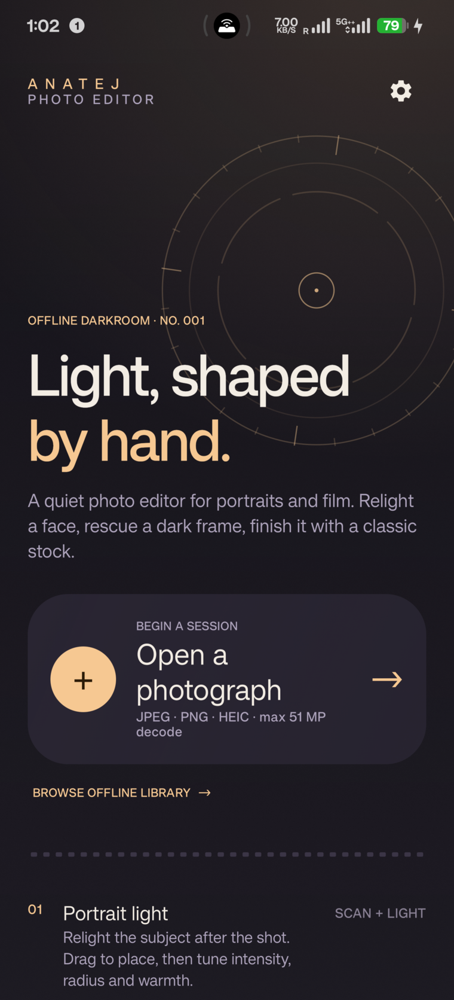
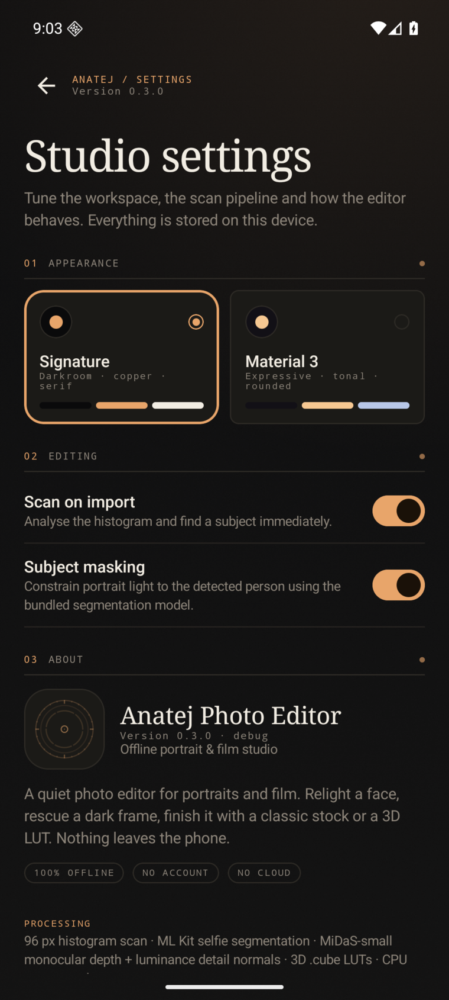
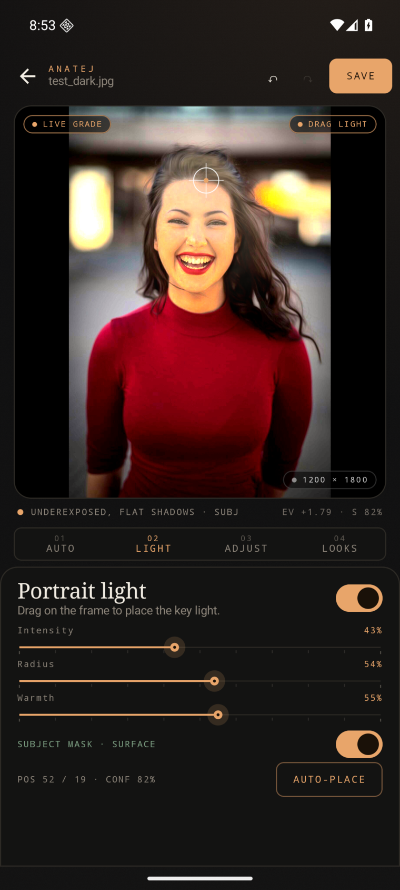
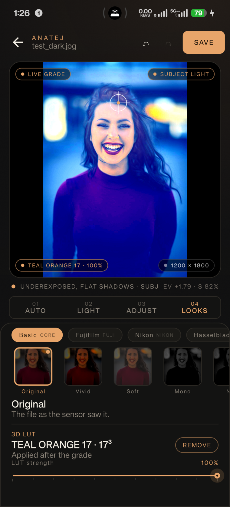
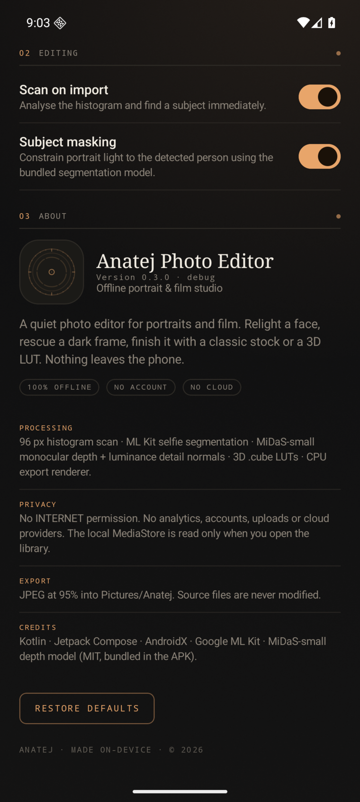
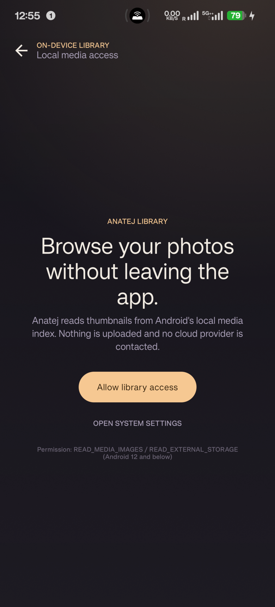

# Anatej Photo Editor

**Anatej Photo Editor** is an offline portrait and film studio for Android. Scanning,
segmentation, relighting, grading, LUTs and export all run on the phone. The manifest
declares **no INTERNET permission**.

Kotlin + Jetpack Compose, with two design languages:

- **Signature** — darkroom paper, copper light, film perforations, serif display type and
  monospace instrument labels.
- **Material 3 Expressive** — large shapes, tonal surfaces and standard Material controls.

The theme now lives in **Settings**, reachable only from the home screen.

| Home | Settings | Portrait light | 3D LUT |
| --- | --- | --- | --- |
|  |  |  |  |

| About | Offline library |
| --- | --- |
|  |  |

## v0.3 features

- **Settings screen + About.** Appearance (Signature / M3 Expressive), scan-on-import,
  subject masking, version/build, processing pipeline, privacy, export and credits.
  Preferences persist in local SharedPreferences.
- **Undo / redo.** 40-step history that coalesces slider drags, with header controls in
  the editor. Works across light, looks, LUTs and Auto-rescue.
- **In-app offline library.** Renders a local MediaStore grid with thumbnails. Explicit
  permission flow, partial-access handling (Android 14+ selected photos), refresh and
  "manage in system settings". No cloud provider is queried.
- **Real 3D `.cube` LUTs.** Strict 3D-only parser (`LUT_3D_SIZE`, RGB triples), trilinear
  sampling, strength slider, persistence across restarts, and import/remove from the Looks
  panel. The LUT is baked into a 1280 px preview base once, then tone/colour adjustments
  stay live through the GPU colour matrix, so sliders no longer wait on a CPU LUT render.
- **Offline subject segmentation + learned-depth relight.** ML Kit selfie segmentation and
  MiDaS-small monocular depth both ship in the APK. A 384 px normal map is built from the
  learned depth with clamped gradients, cover-fit aspect handling, and a 16 px-feathered
  subject matte. A shared directional-softbox model (azimuth/elevation key, softness-weighted
  `1/(1+(d/r)^k)` falloff, skin wrap diffuse, opposing fill, skin-only specular, and shadow
  from `(1−wrap)`) drives both preview and export, so lighting shapes the face instead of
  washing it. Toggleable in Settings and in the Light panel.
- **Subject-aware Auto-rescue.** Whole-frame histograms no longer over-lift a lit face on
  a dark background; exposure is anchored to detected skin/subject luminance, with
  highlight protection for non-portrait frames.
- **Portrait light (OPPO-style simple first).** The panel opens on a single 0–100
  *Brighten face* slider that auto-places on the subject. Advanced tools (direction pad,
  six key presets, radius/softness/fill sliders, bipolar warmth) sit behind a toggle.
  The 0–100 display tops out at the old 30% strength, so max is a gentle ceiling;
  VIEW MASK tint and LIGHT/PAN gesture toggle included. Filmic response keeps small
  values subtle and rolls off highlights. No flat radial wash, no hard matte edge and no round dials.
- **21 looks.** Basic, Fujifilm-, Nikon- and Hasselblad-inspired stocks with live
  per-photo thumbnails and strength.
- **Open with Anatej.** `ACTION_VIEW` / `image/*` support so the app can be chosen from a
  file manager or gallery ("Open with" / "Share to").
- **Zoom / pan.** Pinch to zoom (1–6×), drag to pan when not placing the light, plus a
  floating − / × / + control at the right edge. Tapping the multiplier resets to 1×.
- **Hold to compare.** Press and hold the preview to temporarily reveal the original;
  release to return to the grade. The LIVE GRADE chip still toggles a persistent compare.
- **Matched export.** JPEG at 95% to `Pictures/Anatej` via MediaStore, up to 3000 px,
  including adjustments, look, LUT, depth relight, vignette and grain.
- **Scroll-safe sliders.** Slider gestures claim only horizontal drags; vertical drags are
  left to the surrounding panel, so scrolling from a slider no longer changes its value.

## Permissions

| Permission | Why |
| --- | --- |
| `READ_MEDIA_IMAGES` (Android 13+) / `READ_EXTERNAL_STORAGE` (≤12) | Only for the optional in-app library grid. SAF and the photo picker need no permission. |
| `READ_MEDIA_VISUAL_USER_SELECTED` (Android 14+) | Supports Android's "selected photos only" mode. |
| `INTERNET` / `ACCESS_NETWORK_STATE` | **Not in the merged manifest.** ML Kit declares these transitively; Anatej removes both with `tools:node="remove"`. No network code exists. |

If library access is denied, the app offers the file browser (SAF), the Android photo
picker, or a link to system settings. Importing through SAF or the picker works without
any permission grant.

## Build

Requirements: JDK 17, Android SDK Platform 36, platform-tools.

```bash
echo "sdk.dir=/path/to/Android/Sdk" > local.properties
./gradlew :app:assembleDebug
adb install -r app/build/outputs/apk/debug/app-debug.apk
```

Tests: `./gradlew :app:testDebugUnitTest` (cube parser, trilinear sampling, rejection of
1D/incomplete LUTs).

The debug APK is ~152 MB because it bundles the 33.5 MB MiDaS-small model plus ML Kit and
TensorFlow Lite native libraries for every ABI. A release build with ABI splits or an
`arm64-v8a` App Bundle is the next packaging step. Model attribution is in
`THIRD_PARTY_NOTICES.md` and `app/src/main/assets/MIDAS_LICENSE.txt`.

## Project map

```
app/src/main/java/com/anatej/photo/
├── MainActivity.kt              edge-to-edge host + ACTION_VIEW image intent
├── AnatejApp.kt                 navigation, persisted settings, source chooser
├── data/
│   ├── SettingsStore.kt         local preferences
│   └── PhotoLibrary.kt          MediaStore query + permission helpers
├── model/
│   ├── EditorModels.kt          adjustments, light, looks, analysis, UI state
│   └── Lut3D.kt                 trilinear 3D LUT sampling
├── engine/
│   ├── PhotoAnalyzer.kt         histogram + skin/saliency subject detection
│   ├── PhotoRenderer.kt         CPU export + LUT + depth relight + preview matrix
│   ├── CubeLutParser.kt         .cube parser
│   ├── DepthEstimator.kt        bundled MiDaS-small TFLite depth
│   ├── RelightMap.kt            depth/luminance normals + light/shadow layers
│   └── SubjectSegmenter.kt      bundled ML Kit selfie segmentation
└── ui/
    ├── theme/Design.kt          Signature ↔ Material 3 tokens
    ├── components/              controls, backdrop, aperture mark, source sheet
    ├── home/HomeScreen.kt
    ├── editor/                  viewport, panels, view-model, history, export
    ├── library/LibraryScreen.kt
    └── settings/SettingsScreen.kt
```

## Design notes

- **Why is the theme in Settings?** The editor header is now a working surface: back,
  history, save. Appearance is a global preference, not a per-photo control, so it lives
  on the home-accessible Settings screen.
- **LUT preview path.** A GPU ColorMatrix can't sample a 3D texture, so the LUT is baked
  into the 1280 px preview base once per LUT/strength change. Adjustments and looks remain
  live ColorMatrix operations on top, which is why tone sliders are immediate even with a
  LUT loaded. Export uses the same order: LUT, grade, relight, vignette/grain.
- **Relighting uses learned depth.** MiDaS-small predicts relative inverse depth at
  256×256 (~171 ms on the test device). The depth field is stretched back to the source
  aspect, double-blurred, and converted to normals with clamped gradients so hair and
  background depth edges cannot throw halos. The subject matte travels in the normal-map
  alpha and is box-feathered; the light adds soft spill outside the matte. Directional
  diffuse shading plus a normals-derived shadow are used in preview and export. No network
  or model download is involved.
- **No hidden cloud.** No network code, no account, no telemetry. The only sensitive
  permission is local photo access for the optional library.

## Known limitations / next

- MiDaS-small outputs relative depth at 256×256; the normal map is 384 px on the long edge,
  so sub-pixel facial detail is limited. Extremely flat lighting gives a subtle effect.
- Library access is a runtime permission; SAF and the system picker remain permission-free
  alternatives. Limited "selected photos" mode shows only the chosen subset.
- No crop/rotate, RAW decode, EXIF preservation, batch export, or persistent editing
  sessions across process death.
- Debug APK is ~152 MB due to the bundled depth model, ML Kit and multi-ABI native
  libraries; release packaging/splits are pending.
- Moving the LUT-strength slider still re-bakes the 1280 px base (~90 ms); tone/look
  sliders are immediate.
